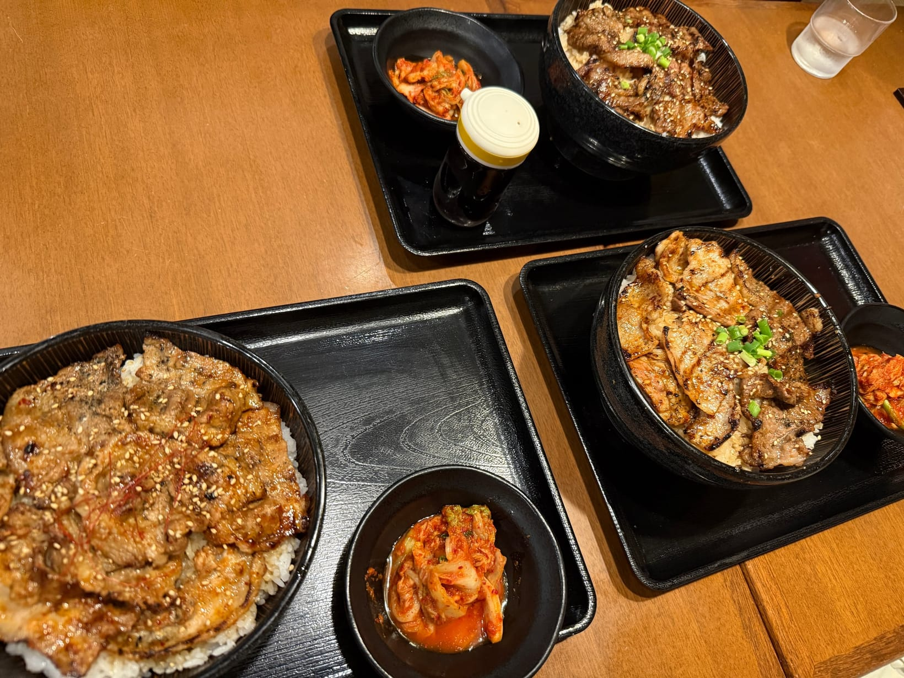

## 開催概要
- **開催日**: 2025年6月11日
- **開催場所**: 中研究棟三階
- **参加者**: 5名
- **内容**: gitの仕組みについて詳しく教わった後、githubで実践し実際にサイトを編集しました。

### 一言
GitHubを使う理由や、使い方などを教わりました。終わった後は、カルビ丼を食べに行きました。（もぐもぐ会）

お肉とキムチが相性抜群でした。
