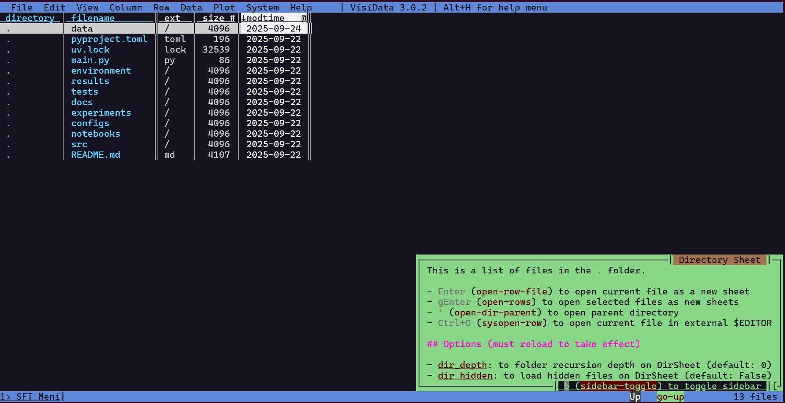

## 開催概要

- **日時**: 2025/10/01
- **人数**: その場にいた4名？

## 一言

コマンドラインからipynbファイルを扱う方法について考えた。  
csvなどの処理はどうするのがいいのか。。  

visidataというcsvを扱えるTUIアプリケーションをいじってみた。
  
vimのような操作ができた（ちょっと心地いい）が、  
プロットなどは悪戦苦闘している。

p.s.  
結婚式ってめんどくさいんですね。  

---
山田
